# Nav Finance 💰

> **A Modern Personal Finance, EMI, Bill & Loan Management System for Windows**  
> Built with **Java 21**, **Modern Swing (FlatLaf)**, and a **Database-Agnostic Relational Architecture** (Embedded **H2 Database** default, with seamless configuration for **MySQL**, **PostgreSQL**, **MariaDB**, and **SQLite** in Settings).

---

## 🌟 Use Case & Problem Solved

Managing daily household finances, recurring bills, EMIs, credit cards, and informal loans (*Loans Given or Taken*) is often painful with generic spreadsheets or cloud apps that compromise privacy.

**Nav Finance** is designed specifically for personal and family finances in India and worldwide:
- **Private & Local-First**: No external cloud tracking. All financial data is securely kept in your embedded H2 database located in your user profile: `~user/nav-finance/navfinance_db.mv.db`, or your self-hosted MySQL / PostgreSQL / MariaDB / SQLite server.
- **Specialized Transaction Management**: Handles One-Time Expenses (Done / Expected), One-Time Incomes (Done / Expected), periodic monthly EMIs, variable Credit Card bills, and utility bills.
- **Strict Non-Returnable Bill Rule**: Outright utility bills, credit cards, and EMI payments are recognized as permanent expenses and **are never treated as loan balances expected back like Given Money**.
- **Entity & Category Tracking Dashboard**: Track any Person, Bill, EMI, Credit Card, or Category across **Days**, **Week**, **Months**, **Quarter**, or **Years** with real-time KPI metrics and visual trend graphs.
- **Personal Loans & Dues Ledger**: Track informal lending and borrowing between friends, relatives, and colleagues with exact contact, relation, and net settlement tracking (*Who owes whom*).
- **Bidirectional Transaction Linking**: Link "Return Received" transactions directly to "Loan Given" transactions (and vice versa) with automatic calculation of partially settled or completely **Nullified** (fully paid) records.
- **Multi-Language Support**: Seamless runtime switching between **English**, **Hindi (हिन्दी)**, and **Hinglish** (Roman Hindi) with clear Indian typography (`Nirmala UI`) preventing tofu/square characters (`□`).
- **Professional Reports & Statements**: Export filtered records with a single click to **PDF**, **Excel (.xlsx)**, or **CSV** complete with active filter criteria summaries and dedicated Master Entity columns.
- **Multi-Database Agnostic Engine**: Switch on-the-fly between embedded H2, MySQL, PostgreSQL, MariaDB, and SQLite with automated schema migration directly from the Settings tab.
- **Audit Details**: Every creation, modification, and deletion records full timestamps and change logs for complete financial integrity.
- **Executive Dashboard**: Visual trends of In vs Out (Green and Red) categorized by **Weekly**, **Monthly**, **Quarterly**, or **Annually**.

---

## 🚀 Key Features

### 1. Specialized Transaction Natures & Workflow
- **One-Time Expense (Done vs Expected)**:
  - Realized expense entries (cash out today) vs Planned future commitments (unrealized expenses).
- **One-Time Received (Done vs Expected)**:
  - Realized earnings/inflows vs Planned future receipts (expected salary, bonus, dividend).
- **EMI Payment (Monthly Installment)**:
  - Links to registered EMI loan catalog, auto-fills monthly installment amount and bank lender.
  - Option to check `[x] Also manage in Due / Upcoming payments schedule` to create recurring trackable reminders.
- **Credit Card Bill (Variable Monthly)**:
  - Accommodates differing monthly statement amounts linked to credit card masters.
  - Due tracking with upcoming payment alerts.
- **Utility / Other Bills (Outright Non-Returnable Expenses)**:
  - Standard recurring utility bills (Electricity, Broadband, Water, Rent, Gas).
  - **Core Rule**: Outright bills paid to vendors or service providers are **never considered as loan balances expected back**, ensuring personal loan ledgers remain completely isolated and accurate.
- **Personal Loan / Transfer**:
  - Peer-to-peer lending and borrowing with bidirectional settlement linking and nullification.

### 2. Bidirectional Transaction Linking & Nullified Status
- **Link Given & Return Transactions**:
  - For any **Return Received** transaction (Income), easily link it to one or more prior **Loan Given** (Expense) transactions.
  - For any **Loan Given** transaction (Expense), link it to incoming **Return Received** settlements.
- **Visual Status Badges**:
  - `🟢 Nullified (Fully Settled)`: Distinctive styling indicating the loan or return is 100% squared off.
  - `🟡 Partially Settled`: Displays the exact remaining unlinked balance.
  - `⚪ Open / Unlinked`: Indicates an unsettled loan or advance.
- **Link Management Modal**:
  - View all existing transaction links with breakdown of linked amounts.
  - Add new links or unlink settlements with single-click actions and automatic ledger recalculations.

### 3. Multi-Language System (English, Hindi & Hinglish)
- **Three Supported Languages**:
  1. **English**: Clean, standardized professional English terminology.
  2. **Hindi (हिन्दी)**: Formal Hindi translation using native Devanagari script.
  3. **Hinglish**: Conversational Hindi written in Latin script (e.g., *Kharcha*, *Kamai*, *Udhar Diya*, *Hisab-Kitab*).
- **Runtime Switching**: Instant UI language update from the top bar dropdown (`🌐 English / हिन्दी / Hinglish`) without restarting the app.
- **Typography & Tofu (`□`) Prevention**:
  - Powered by **`Nirmala UI`** (with automatic fallback to `Mangal` or system SansSerif), ensuring 100% glyph coverage for Hindi characters, INR (`₹`), and Latin text.
  - Automatically updates FlatLaf window title bar (`TitlePane.font`), KPI badges, charts, dialogs, and table headers.

### 4. Comprehensive Masters Catalog
- **Persons Master**: Maintains list of contacts with `Name`, `Contact`, `Relation` (Friend, Colleague, Relative, Family, Landlord), and `Notes`.
- **Bills Master**: Pre-configured utility bills (e.g., *Airtel Bill*, *Electricity (Khardoni)*, *Electricity (Noida)*, *IGL Gas*, *Water*) with default expected amounts.
- **EMI Master**: Pre-configured recurring loan installments (e.g., *Home Loan EMI*, *Car Loan EMI*, *Personal Loan*, *Laptop EMI*) with monthly dues and lender bank.
- **Credit Cards Master**: Store bank name, card name, and last 4 digits for easy expense attribution.
- **Payment Modes**: Manage payment modes used across transactions.

### 5. Personal Loans & Dues Ledger
- Dedicated ledger computing:
  - **Total Lent** (money lent to others)
  - **Total Returned** (money returned by others)
  - **Total Borrowed** (money borrowed from others)
  - **Total Repaid** (money paid back by you)
  - **Net Balance** (clearly indicates *Owes You* in Green or *You Owe* in Red)

### 6. Interactive UI & Analytics Dashboard
- **Period Breakdown**: Switch seamlessly between **Weekly**, **Monthly**, **Quarterly**, and **Annually** with `< Prev` and `Next >` timeline navigation.
- **KPI Summary Cards**:
  - **Total Income (In)** in **Green**
  - **Total Expense (Out)** in **Red**
  - **Net Balance / Savings** in **Blue**
  - **Loan Position** in **Amber**
- **Trend Chart**: Dual-colored Bar Chart comparing In (Green) vs Out (Red) over time.
- **Category Donut Chart**: Visual distribution of expenses by category with percentages and legends.
- **Recent Activity**: Quick view of latest 10 transactions.

### 7. Multi-Criteria Filtering & Sorting
- **Filter By**:
  - Type (`All`, `Income`, `Expense`)
  - Category & Dynamic Sub-Category
  - Payment Mode (`Via`)
  - Associated Person
  - Date Presets (`Today`, `This Week`, `This Month`, `This Quarter`, `This Year`, `Custom Range`)
  - Min / Max Amount range
  - Keyword Search (across notes, subcategory, and person names)
- **Sort By**:
  - Type (In/Out), Category, Sub-Category, Amount, Date (Ascending / Descending)

### 8. Audit Trail & Change Logging
- Automatic logging of all **CREATE**, **UPDATE**, and **DELETE** actions.
- Captures precise timestamps, entity modified, and human-readable diff details (e.g., *Amount changed from ₹2,000.00 to ₹2,500.00; Via: Cash -> UPI*).

### 9. Enhanced Professional Reports & Exports
- **Export Filtered Results to PDF**: Clean document with header metadata, active filter summary banner (Date range, Categories, Masters, Payment modes, Amount limits), 4 KPI summary cards, dedicated Master Entity column, colored badges, and itemized table via OpenPDF.
- **Export Filtered Results to Excel (.xlsx)**: Professionally styled workbook with currency numbers, distinct Master Entity column, active filter summary, colored rows, and double-line totals via Apache POI.
- **Export Filtered Results to CSV**: Standard RFC 4180 comma-separated file with full master entity attributes.
- **Export All Database as CSV Files**: One-click dump of all database tables into individual CSV files.

### 10. Bulk CSV Import, Update & Deletion
- **Import Dialog**: Upload any standard CSV file to perform bulk transactions.
- **Download CSV Template**: One-click generation of `nav_finance_template.csv` containing instructions and sample rows for `CREATE`, `UPDATE`, and `DELETE` actions.
- **Auto Validation & Color-Coded Preview**: Table validation showing row numbers, badge-coded actions (`CREATE` in Green, `UPDATE` in Blue, `DELETE` in Red), and instant validation feedback.
- **Batch Execution**: Executes all valid lines in a single batch, updating person links, auto-registering novel payment modes, and logging audit events for each change.

### 11. Dynamic Zoom In / Out & Overlap-Free UI Scaling
- **Header Controls**: Magnify the UI using `🔍+` (Zoom In) and `🔍-` (Zoom Out), or click the percentage badge (e.g., `100%`) to reset.
- **Scaling Range**: Scalable across `80%`, `90%`, `100%`, `115%`, `130%`, `150%`, and `175%`.
- **Overlap Prevention**: Flow and wrap responsive layouts prevent clipping, overlapping buttons, or truncated date pickers on high-zoom displays (130%, 150%, 175%).
- **Keyboard Shortcuts**:
  - `Ctrl` + `+` / `Ctrl` + `=`: Zoom In
  - `Ctrl` + `-`: Zoom Out
  - `Ctrl` + `0`: Reset Zoom to 100%

### 12. Recurring Payment Schedules & Due Payment Tracker
- **Specific Day of Month**: Configure recurring obligations on any day from `1` to `31` (e.g., *EMI of ₹20,000 on 5th of every month*).
- **Fixed vs Variable Amounts**: Support for fixed commitments (EMIs, rent) and variable utility bills (electricity, water, credit cards).
- **Due & Overdue Status Tracker**: Real-time KPI cards for **Overdue**, **Upcoming Due**, **Settled**, and **Auto vs Manual Ratio**.
- **Interactive Settlement**: Prompts for exact amount and records expense entries directly into the ledger, automatically linking the underlying Master entity.

### 13. Entity & Category Tracking Dashboard (Track & Analyze 📊)
- **Dedicated 2-Tab Transactions View**:
  - **Tab 1 (All Transactions)**: Ledger with multi-criteria filters (including Master entity filter) and settlement tools.
  - **Tab 2 (Track & Analyze)**: Interactive dashboard for deep-dive tracking of any **Person**, **Utility Bill**, **EMI Installment**, **Credit Card**, or **Category**.
- **Multi-Granularity Time Bucketing**:
  - View transactions and interactive visual graph grouped by **Days**, **Week**, **Months**, **Quarter**, or **Years**.
  - Computed using pure Java calendar arithmetic (`java.time.LocalDate`), guaranteeing zero SQL dialect divergence across databases.
- **4 Real-Time Metric Cards**: Total Inflow, Total Outflow, Net Balance, and Average volume per Period.
- **Visual Trend Graph**: Dynamic anti-aliased dual-bar chart showing inflow vs outflow trends with period labels.
- **Itemized Ledger & Statement Export**: Complete table of matched entries with one-click Excel and PDF statement export.
- **One-Click Deep Links**:
  - Click **Track & Graph 📊** directly in **Masters** (Persons, Bills, EMIs, Cards) or **Loans & Dues** to immediately inspect that entity's historical trend and visual graph.

### 14. Multi-Database Architecture & Configuration in Settings
- **Database Engine Agnostic**: Core business logic, queries, and filters are 100% decoupled from the underlying SQL engine.
- **Supported Engines**:
  - **H2 (Embedded - Default)**: Zero-configuration local database stored at `~user/nav-finance/navfinance_db.mv.db`.
  - **MySQL 8.x**: Ideal for central servers or multi-device setups.
  - **PostgreSQL 14+ / 16+**: Enterprise-grade relational storage.
  - **MariaDB 10.x / 11.x**: High-performance open-source database.
  - **SQLite**: Single-file standalone database.
- **Settings Panel Management**:
  - Configure Host, Port, Database Name, Username, Password, or Custom JDBC URL.
  - Live Connection URL preview with connection timeout controls.
  - **Test Connection** with millisecond diagnostic feedback before applying.
  - **Live Switch**: Connects, executes automated schema DDL tables and indexes, seeds default payment modes, and migrates runtime queries seamlessly.
  - **One-Click Reset**: Safely revert to default embedded H2 at any time.

---

## 🗄️ Database Architecture & Entity Relationships

The embedded database is created automatically upon first run at:
```text
C:\Users\<username>\nav-finance\navfinance_db.mv.db
```
- **Engine**: H2 Database 2.2
- **Mode**: Embedded Multi-Process (`AUTO_SERVER=TRUE;DB_CLOSE_DELAY=-1`)

### Entity-Relationship (ER) Diagram

```mermaid
erDiagram
    PERSONS ||--o{ TRANSACTIONS : "person_id"
    BILLS ||--o{ TRANSACTIONS : "bill_id"
    EMIS ||--o{ TRANSACTIONS : "emi_id"
    CREDIT_CARDS ||--o{ TRANSACTIONS : "credit_card_id"
    TRANSACTIONS ||--o{ TRANSACTION_LINKS : "give_tx_id"
    TRANSACTIONS ||--o{ TRANSACTION_LINKS : "return_tx_id"
    RECURRING_SCHEDULES ||--o{ DUE_PAYMENTS : "schedule_id"
    TRANSACTIONS ||--o{ DUE_PAYMENTS : "transaction_id"

    PERSONS {
        BIGINT id PK "Auto Increment"
        VARCHAR name "Full contact name"
        VARCHAR contact "Phone / Email"
        VARCHAR relation "Friend, Family, Colleague, Landlord"
        VARCHAR notes "General notes"
        TIMESTAMP created_at "Creation timestamp"
        TIMESTAMP updated_at "Update timestamp"
    }

    BILLS {
        BIGINT id PK "Auto Increment"
        VARCHAR bill_name "Bill name (e.g., Airtel, Electricity)"
        VARCHAR provider "Utility provider"
        DECIMAL default_amount "Expected default amount"
        VARCHAR notes "Account or meter number"
        TIMESTAMP created_at "Creation timestamp"
        TIMESTAMP updated_at "Update timestamp"
    }

    EMIS {
        BIGINT id PK "Auto Increment"
        VARCHAR emi_name "Loan title (Home Loan, Car Loan)"
        VARCHAR bank_lender "Financing bank or NBFC"
        DECIMAL monthly_amount "Monthly installment amount"
        VARCHAR notes "Loan account details"
        TIMESTAMP created_at "Creation timestamp"
        TIMESTAMP updated_at "Update timestamp"
    }

    CREDIT_CARDS {
        BIGINT id PK "Auto Increment"
        VARCHAR card_name "Card brand / product name"
        VARCHAR bank "Issuing bank"
        VARCHAR last_digits "Last 4 digits"
        TIMESTAMP created_at "Creation timestamp"
        TIMESTAMP updated_at "Update timestamp"
    }

    PAYMENT_MODES {
        BIGINT id PK "Auto Increment"
        VARCHAR mode_name UK "Cash, UPI, Paytm, Net Banking"
        BOOLEAN is_system "Pre-seeded system mode"
        TIMESTAMP created_at "Creation timestamp"
    }

    TRANSACTIONS {
        BIGINT id PK "Auto Increment"
        VARCHAR type "INCOME or EXPENSE"
        DATE tx_date "Transaction / Planned Date"
        BOOLEAN is_expected "Flag for planned entries"
        DECIMAL amount "Transaction value (15, 2)"
        VARCHAR payment_via "Payment Mode name"
        VARCHAR category "Primary category"
        VARCHAR sub_category "Dynamic subcategory or description"
        BIGINT person_id FK "References PERSONS(id)"
        BIGINT bill_id FK "References BILLS(id)"
        BIGINT emi_id FK "References EMIS(id)"
        BIGINT credit_card_id FK "References CREDIT_CARDS(id)"
        VARCHAR notes "Additional notes"
        TIMESTAMP created_at "Creation timestamp"
        TIMESTAMP updated_at "Update timestamp"
    }

    TRANSACTION_LINKS {
        BIGINT id PK "Auto Increment"
        BIGINT give_tx_id FK "References TRANSACTIONS(id) [Give/Expense]"
        BIGINT return_tx_id FK "References TRANSACTIONS(id) [Return/Income]"
        DECIMAL amount "Settled linked amount"
        VARCHAR notes "Settlement note"
        TIMESTAMP created_at "Creation timestamp"
    }

    RECURRING_SCHEDULES {
        BIGINT id PK "Auto Increment"
        VARCHAR name "Schedule name (e.g., Rent, EMI)"
        VARCHAR type "INCOME or EXPENSE"
        VARCHAR category "Schedule category"
        VARCHAR sub_category "Schedule subcategory"
        INT day_of_month "Execution day of month (1-31)"
        VARCHAR amount_type "FIXED or VARIABLE"
        DECIMAL default_amount "Default estimated amount"
        DATE start_date "Schedule activation date"
        DATE end_date "Schedule termination date"
        VARCHAR payment_via "Default payment mode"
        BOOLEAN is_auto_pay "Auto-debit mandate flag"
        VARCHAR notes "Schedule instructions"
        BOOLEAN active "Active status flag"
        TIMESTAMP created_at "Creation timestamp"
        TIMESTAMP updated_at "Update timestamp"
    }

    DUE_PAYMENTS {
        BIGINT id PK "Auto Increment"
        BIGINT schedule_id FK "References RECURRING_SCHEDULES(id)"
        VARCHAR title "Due item title"
        VARCHAR type "INCOME or EXPENSE"
        VARCHAR category "Due category"
        VARCHAR sub_category "Due subcategory"
        DATE due_date "Scheduled payment date"
        DECIMAL expected_amount "Expected obligation amount"
        BOOLEAN is_variable "Variable amount flag"
        BOOLEAN is_auto_pay "Auto-debit flag"
        VARCHAR status "PENDING, OVERDUE, SETTLED"
        DECIMAL settled_amount "Actual settled amount"
        DATE settled_date "Actual date paid"
        VARCHAR settled_via "Actual payment mode"
        BIGINT transaction_id FK "References TRANSACTIONS(id)"
        VARCHAR notes "Settlement notes"
        TIMESTAMP created_at "Creation timestamp"
    }

    AUDIT_LOGS {
        BIGINT id PK "Auto Increment"
        VARCHAR entity_type "TRANSACTION, PERSON, BILL, etc."
        BIGINT entity_id "Modified entity ID"
        VARCHAR action "CREATE, UPDATE, DELETE"
        VARCHAR details "Change diff summary"
        TIMESTAMP log_timestamp "Audit event timestamp"
    }
```



### Table Summary & Primary Constraints

| Table Name | Primary Purpose | Key Foreign Keys | Unique / Important Indexes |
| :--- | :--- | :--- | :--- |
| **`transactions`** | Core ledger entries for income and expenses. | `person_id`, `bill_id`, `emi_id`, `credit_card_id` | `idx_tx_date`, `idx_tx_type`, `idx_tx_category` |
| **`transaction_links`** | Connects Loan Given expenses with Return Received income. | `give_tx_id`, `return_tx_id` (CASCADE delete) | `UNIQUE (give_tx_id, return_tx_id)`, `idx_link_give`, `idx_link_return` |
| **`persons`** | Contacts directory for loans, dues, and relatives. | None | Primary Key (`id`) |
| **`bills`** | Utility bills and recurring provider master. | None | Primary Key (`id`) |
| **`emis`** | Loan installments and lender bank master. | None | Primary Key (`id`) |
| **`credit_cards`** | Stored credit cards and issuing banks. | None | Primary Key (`id`) |
| **`payment_modes`** | Standard and customized payment channels. | None | `mode_name` (UNIQUE) |
| **`recurring_schedules`** | Rules for repeating monthly obligations. | None | Primary Key (`id`) |
| **`due_payments`** | Materialized monthly obligations with due dates. | `schedule_id`, `transaction_id` | `idx_due_date`, `idx_due_status` |
| **`audit_logs`** | Tamper-evident ledger history of all operations. | None | `idx_audit_time` |

---

## 🛠️ Project Structure

```text
nav-finance/
├── pom.xml                               # Maven build descriptor (Java 21, FlatLaf, H2, POI, OpenPDF)
├── .gitignore                            # Windows, IDE, and build artifact exclusions
├── run.bat                               # Windows Batch double-click launcher
├── run.ps1                               # PowerShell launcher script
├── build.bat                             # Automated native installer builder (JAR, Zip, MSI)
├── README.md                             # Comprehensive project documentation & ER diagram
├── USER_GUIDE.md                         # Detailed end-user manual & operations handbook
├── src/
│   ├── main/
│   │   ├── resources/
│   │   │   └── i18n/
│   │   │       ├── messages_en.properties       # English UI strings & templates
│   │   │       ├── messages_hi.properties       # Hindi (हिन्दी) Devanagari strings
│   │   │       └── messages_hinglish.properties # Hinglish conversational strings
│   │   └── java/com/navfinance/
│   │       ├── Main.java                        # App entry point, FlatLaf & font initialization
│   │       ├── config/
│   │       │   └── AppConfig.java               # Global paths, formatters, and currencies
│   │       ├── database/
│   │       │   ├── DatabaseConfig.java              # Database configuration model & connection strings
│   │       │   ├── DatabaseManager.java             # Connection pool, engine switching, CSV backup engine
│   │       │   ├── DatabaseType.java                # H2, MYSQL, POSTGRESQL, MARIADB, SQLITE enum
│   │       │   └── DbSchemaManager.java             # Dialect-specific DDL scripts & schema initializers
│   │       ├── i18n/
│   │       │   ├── AppLanguage.java             # ENGLISH, HINDI, HINGLISH enum
│   │       │   └── I18n.java                    # Bundle manager, listeners, Nirmala UI font resolution
│   │       ├── model/
│   │       │   ├── AmountType.java              # FIXED vs VARIABLE amount enum
│   │       │   ├── DuePayment.java              # Due payment entity
│   │       │   ├── DueStatus.java               # PENDING, OVERDUE, SETTLED enum
│   │       │   ├── EntityTrackerSummary.java        # Entity trend, inflow/outflow, and granular buckets
│   │       │   ├── RecurringSchedule.java       # Recurring schedule rule entity
│   │       │   ├── Transaction.java             # Transaction entity
│   │       │   ├── TransactionType.java         # INCOME / EXPENSE enum
│   │       │   ├── TransactionLink.java         # Give vs Return linking entity
│   │       │   ├── TransactionSettlementInfo.java # Settlement status, linked amount, remaining balance
│   │       │   ├── SettlementStatus.java        # UNLINKED, PARTIAL, FULLY_SETTLED enum
│   │       │   ├── Person.java                  # Contact master entity
│   │       │   ├── Bill.java                    # Bill master entity
│   │       │   ├── Emi.java                     # EMI master entity
│   │       │   ├── CreditCard.java              # Credit card master entity
│   │       │   ├── AuditLog.java                # Audit trail entity
│   │       │   ├── FilterCriteria.java          # Multi-criteria filter & sort state
│   │       │   └── DashboardSummary.java        # Period summary metrics & chart datasets
│   │       ├── dao/
│   │       │   ├── DuePaymentDao.java           # Due payments CRUD & settlement tracking
│   │       │   ├── RecurringScheduleDao.java    # Recurring schedule rules repository
│   │       │   ├── TransactionDao.java          # Transaction persistence, queries & filters
│   │       │   ├── TransactionLinkDao.java      # Transaction link repository & settlement joins
│   │       │   ├── PersonDao.java               # Person CRUD
│   │       │   ├── BillDao.java                 # Bill CRUD
│   │       │   ├── EmiDao.java                  # EMI CRUD
│   │       │   ├── CreditCardDao.java           # Credit Card CRUD
│   │       │   ├── PaymentModeDao.java          # Payment mode repository
│   │       │   └── AuditDao.java                # Audit log repository
│   │       ├── service/
│   │       │   ├── FinanceService.java          # Business logic, link orchestrator, audit events
│   │       │   ├── AnalyticsService.java        # Dashboard KPI metrics & trend chart computations
│   │       │   ├── ExportService.java           # PDF, Excel (.xlsx), and CSV exporters
│   │       │   ├── CsvImportService.java        # Bulk CSV parsing, validation, batch updates
│   │       │   └── RecurringService.java        # Recurring schedule generation & due settlements
│   │       └── ui/
│   │           ├── MainFrame.java               # Main window, navigation tabs, language switcher, zoom
│   │           ├── util/
│   │           │   ├── UiUtils.java             # Dynamic typography, palette colors, UI helpers
│   │           │   ├── NavIcons.java            # Vector SVG / Java2D icon graphics
│   │           │   └── ZoomManager.java         # Dynamic UI scaling engine (80% - 175%)
│   │           ├── components/
│   │           │   ├── DatePickerField.java     # Dual manual entry + calendar popup picker
│   │           │   ├── KpiCard.java             # Gradient KPI card with dynamic typography refresh
│   │           │   ├── TrendChartPanel.java     # Anti-aliased 2D Bar Chart (In vs Out)
│   │           │   └── CategoryPieChartPanel.java # Anti-aliased 2D Donut Chart
│   │           ├── dialogs/
│   │           │   ├── TransactionDialog.java   # Dynamic Income/Expense modal dialog
│   │           │   ├── LinkTransactionDialog.java # Modal to link Give and Return transactions
│   │           │   ├── CsvImportDialog.java     # CSV preview, validation & batch executor
│   │           │   ├── RecurringScheduleDialog.java # Recurring schedule configuration
│   │           │   ├── SettlePaymentDialog.java # Variable/Fixed due settlement dialog
│   │           │   ├── PersonDialog.java        # Contact modal dialog
│   │           │   ├── BillDialog.java          # Bill modal dialog
│   │           │   ├── EmiDialog.java           # EMI modal dialog
│   │           │   └── CreditCardDialog.java    # Credit card modal dialog
│   │           └── panels/
│   │               ├── DashboardPanel.java      # Executive KPI & visual trends panel
│   │               ├── TransactionsPanel.java   # 2-Tab: All Transactions + Track & Analyze Dashboard
│   │               ├── DuePaymentsPanel.java    # Due tracker & recurring rules manager
│   │               ├── LoansDuesPanel.java      # Person-wise loan & dues ledger with Track links
│   │               ├── MastersPanel.java        # Masters management tabs with Track & Graph links
│   │               ├── AuditLogPanel.java       # Audit trail viewer
│   │               ├── UserGuidePanel.java      # Searchable in-app user guide
│   │               ├── AboutUsPanel.java        # Runtime metrics & local-first specifications
│   │               └── SettingsPanel.java       # Multi-DB configuration, CSV backup & themes
│   └── test/java/com/navfinance/
│       ├── database/
│       │   └── DatabaseConfigurationTest.java   # Multi-engine dialect & connection verification
│       ├── service/
│       │   ├── EntityTrackerTest.java           # Verifies Days-Years bucketing & non-returnable bill isolation
│       │   ├── ExportReportTest.java            # Verifies PDF/Excel export with Master & Filter summary
│       │   └── TransactionLinkTest.java         # Verifies bidirectional settlement math & nullification
│       ├── ui/
│       │   └── ResponsiveBarPanelTest.java      # Verifies zoom layout without component clipping
│       ├── FontRenderingTest.java               # Verifies Devanagari glyph coverage without tofu
│       ├── WindowBoundsPersistenceTest.java     # Verifies window coordinate persistence
│       └── ZoomPersistenceTest.java             # Verifies zoom level persistence
```

---

## ⚙️ Prerequisites

- **Java JDK**: 21 or higher (Oracle JDK, GraalVM JDK 21, Eclipse Temurin 21)
- **Maven**: 3.8+ or 3.9+
- **Operating System**: Windows 10 or 11 (includes native support for `Nirmala UI` font)

---

## 🚀 How to Build & Run

### Method 1: Using Windows Double-Click Launcher
Double-click `run.bat` in the project directory. It compiles the project (if not already compiled) and opens the application window.

### Method 2: Using PowerShell
```powershell
.\run.ps1
```

### Method 3: Using Maven Command Line
```powershell
# 1. Compile and package the executable JAR
mvn clean package

# 2. Run the packaged Fat JAR
java -jar target/nav-finance-1.0.0.jar
```

---

## 📦 Building Native Installers & Distribution Artifacts

Nav Finance includes automated tooling to generate standalone and production-ready distribution packages:

### Automated One-Click Build Script
Run the automated installer builder script:
```cmd
build.bat
```
*(or run `scripts\build-installers.bat`)*

This script automatically executes Maven shading, verifies artifacts, and runs JDK `jpackage` + WiX Toolset to build all three formats in `target/artifacts/`:

| Artifact | Location | Description |
| :--- | :--- | :--- |
| **Standalone Executable Fat JAR** | `target/artifacts/NavFinance-1.0.0.jar` | Portable shaded JAR with all dependencies included (requires Java 21). |
| **Portable App with Bundled JRE** | `target/artifacts/NavFinance-1.0.0-jre21-winX64.zip` | Standalone portable `.zip` containing `NavFinance.exe` and a bundled JRE 21 runtime (runs without needing Java installed on target Windows machine). |
| **Windows Native MSI Installer** | `target/artifacts/NavFinance-1.0.0.msi` | Windows installer with Desktop shortcut, Start Menu group (`NavFinance`), and install directory selection. |

> **Note**: Building `.msi` installers requires the **WiX Toolset v3.0+** (`candle.exe` and `light.exe`) installed and accessible in the system PATH.

---

## 📄 License
This project is licensed under the MIT License - see the `LICENSE` file for details.
